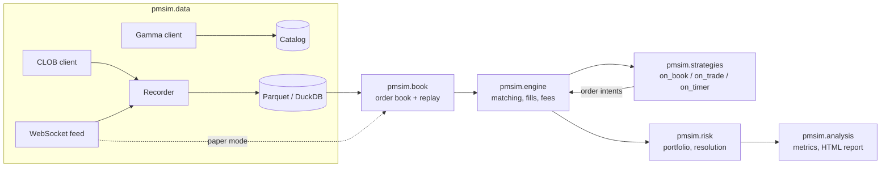

# polysim-lab

A simulator and backtester for testing trading algorithms on Polymarket
prediction markets. It never places real orders and holds no private keys.

Status is tracked in PROGRESS.md. The build plan is in docs/BUILD_SPEC.md.

## Architecture



## Quick start

```
uv sync
make check
uv run pmsim --version
```

Configuration lives in `config/default.yaml` and is loaded with
`pmsim.config.load_config`.
