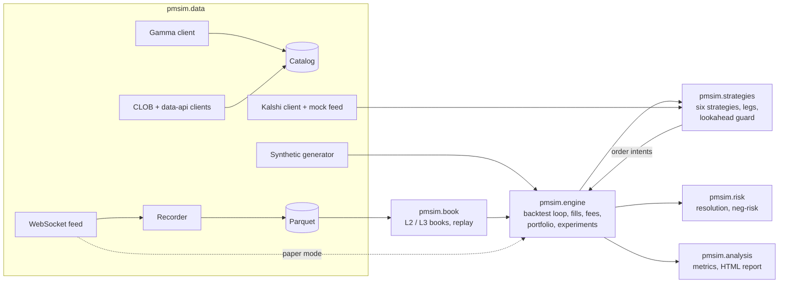

# polysim-lab

A simulator and backtester for testing trading algorithms on Polymarket
prediction markets. It never places real orders and holds no private keys;
tests fail if any trading or signing code appears.

Status is tracked in PROGRESS.md, design choices in DECISIONS.md, and the
build plan in docs/BUILD_SPEC.md.

## Architecture



## Dashboard

```
uv run pmsim ui          # opens http://127.0.0.1:8765
```

A local web dashboard with a Polymarket-inspired look (its own styling, not
Polymarket's assets; not affiliated):

- **Markets**: catalog grouped by event with chance, Yes/No prices and 24 h
  volume from the last `pmsim fetch`; click a market for its recorded order
  book.
- **Backtest**: pick a strategy, synthetic or recorded data and parameters;
  see PnL, risk metrics, the equity curve, stress tests, theory vs realized
  edge, every trade and every rejected order.
- **Compare**: all six strategies on the same data, theory vs realized.
- **Paper trading**: live view of `pmsim paper` sessions, refreshed every 3 s.

Links like `#backtest?strategy=logical&hours=6&stress=1&run=1` or
`#markets?q=fed` open a configured view. It follows the system light or dark
setting; the Theme button overrides it. The server binds to 127.0.0.1 and only
runs simulations and reads local files.

## How to run it

Requirements: Python 3.12+ and [uv](https://docs.astral.sh/uv/).

```
uv sync          # install
make check       # ruff, mypy, pytest with an 85% coverage floor on engine and book
make bench       # time a 24 h synthetic replay for every strategy
```

### 1. Get market data (read-only)

```
uv run pmsim fetch --limit 500                                # catalog -> data/catalog.parquet
uv run pmsim record --markets "tag:fed,neg_risk" --hours 1    # books + trades -> data/raw/
```

`--markets` takes comma separated terms (OR-ed): a slug substring,
`tag:<slug>`, or `neg_risk`. Only open markets are recorded. Recorded tables
are `book_snapshots`, `book_deltas`, `trades` and `tick_size_changes`; every
row has `exchange_ts_ms` and `recv_ts_ms`.

### 2. Backtest

```
uv run pmsim backtest --strategy complementary                # synthetic data (default)
uv run pmsim backtest --strategy logical --stress --workers 4 # base + latency, depth, fee stress
uv run pmsim backtest --strategy market_making --data recorded --report reports/mm.html
uv run pmsim edges                                            # theoretical vs realized edge
```

Strategies: `complementary`, `negrisk_sum`, `near_resolution`, `logical`,
`market_making`, `cross_platform`. Pass parameters as JSON with
`--params '{"min_edge_usd_per_share": 0.01}'`. Every summary and report says
whether it ran on `synthetic` or `recorded` data. A strategy passes the
stress test only if it stays positive in the base run and under each stress.

Sweeps and walk-forward splits are in `pmsim.engine.experiment`
(`sweep`, `walk_forward`, `stress_test`, `run_many` with a process pool).

### 3. Paper trade

```
uv run pmsim paper --strategy market_making --markets "tag:fed" --hours 1
```

Runs the strategy on the live feed with the backtest fill model. Decisions
go to `data/paper/<session>.log.jsonl` with a reason each; the portfolio is
saved to `data/paper/<session>.state.json` and resumed on restart.

## Read before trusting a number

- docs/METRICS.md: what each metric means.
- docs/ASSUMPTIONS.md: fee model and its date, latency, queue model,
  resolution risk.
- docs/LIMITATIONS.md: what the simulator cannot predict. In the recorded
  sample YES and NO books mirror each other exactly, so single-market
  complementary arbitrage looks absent on Polymarket; synthetic profits come
  from mispricings the generator injects.

Configuration lives in `config/default.yaml` (`pmsim.config.load_config`).
